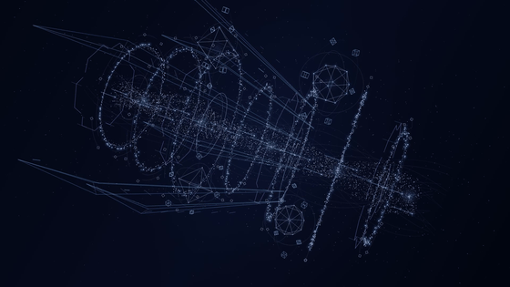
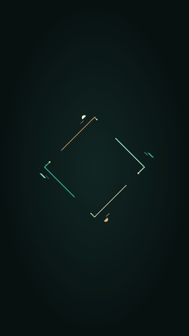
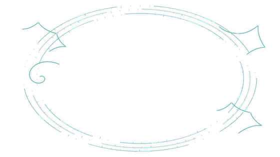

# 创作 Skill 简明说明书

从你想交付的东西出发选 skill。做一整段有空间感的动效，用 **星轨几何动效**。想让观众跟着笔头看轮廓成形，用 **线形接力**。需要一件能叠到别处的小动画，用 **小型透明线条动画**。

## 1. 星轨几何动效 · arcane-motion

制作有空间层次和镜头运动的星轨、科技线条、魔法阵动画。内含 Remotion + Canvas 模板，可以从已有动画改节奏、光效和镜头。

**可以这样用** · `$arcane-motion 做一段蓝白星环启动动画。外环先转，粒子向中心汇聚，镜头在亮起时拉远。`

*《星核重炮·超载释放》片段。看外圈、粒子和镜头如何一起推进蓄力与释放。*

## 2. 线形接力 · line-form-motion

制作二维描线、图形出场和签名转场。可以控制从哪里起笔、线头和线尾怎么走，以及色带在交接处如何穿插。

**可以这样用** · `$line-form-motion 让暖金细线和青绿色带从两处起笔，在菱形拐角接力，最后沿边缘退场。`

*《折光接力》片段。留意细线先过拐角，宽色带随后跟上。*

## 3. 小型透明线条动画 · minimal-line-motion

做猫耳、翅膀、尾巴、星月这类可以单独合成的小动画。可以拆透明图层分别做动作，也可以用贝塞尔曲线重画，最后导出带透明通道的 MOV。

**可以这样用** · `做一个透明底的猫耳和小翅膀动画。耳尖轻抖，双翼慢速开合，交付透明 MOV 和预览。`

*《小猫耳翅膀透明动作试验》片段。GIF 用深色背景展示，原试片另有透明 MOV。*

## 4. 透明几何动态装饰 · transparent-geometry-overlay

为已有立绘、视频或签名设计前景和背景几何装饰。可以从透明 PNG 首帧开始，继续写分层方案和 5 秒或 10 秒的动态提示词，也包含带透明通道的 MOV 导出指导。

**可以这样用** · `为竖屏角色登场设计青银色圆环和短刻线。中间留给角色，给我独立透明 PNG 和一段 5 秒动态方案。`

*既有透明几何试片的单帧，用来示意这类装饰图层。*

## 5. Midjourney 提示词与出图诊断 · midjourney-prompt-2.0

从参考图提取构图、光线和气氛，转成英文 Midjourney 提示词。也可以拿实际出图来诊断，保留满意的部分，并给出一条完整的替换提示词。

**可以这样用** · `根据参考图写一条英文 MJ 提示词。保留雨后石桥的冷暖关系，人物缩小到画面右下，桥面水光引向人物。`

## 在 Codex 里使用

- 本机已装好 `$arcane-motion` 和 `$line-form-motion`，可以直接在需求前加上 skill 名。
- 其余三份可先把对应的 skill 文件交给 Codex 阅读。有模板或参考文档的，把配套目录一起保留。
- 本地归档确认前三份是自制 skill。透明几何装饰和 Midjourney 提示词这两份的创建来源待核实。
